# Bukti Alur Utama Aplikasi Helpdesk

Dokumen ini menjelaskan alur penggunaan aplikasi melalui **sebelas tangkapan layar asli**, mulai dari masuk akun sampai laporan ditutup. Gambar diambil dari aplikasi yang benar-benar dijalankan, bukan rancangan tampilan.

Seluruh contoh menggunakan akun dan data percobaan di lingkungan terpisah, sehingga tidak mengubah data aplikasi utama. Tanggal pengambilan: **19 November 2026**.

## Ringkasan

**Pelapor masuk → melihat daftar tiket → membuat tiket dan melampirkan file → petugas menangani tiket → pelapor melihat perkembangan dan pratinjau lampiran komentar → petugas menyelesaikan tiket → pelapor mengonfirmasi dan menutup tiket → pengelola melihat statistik.**

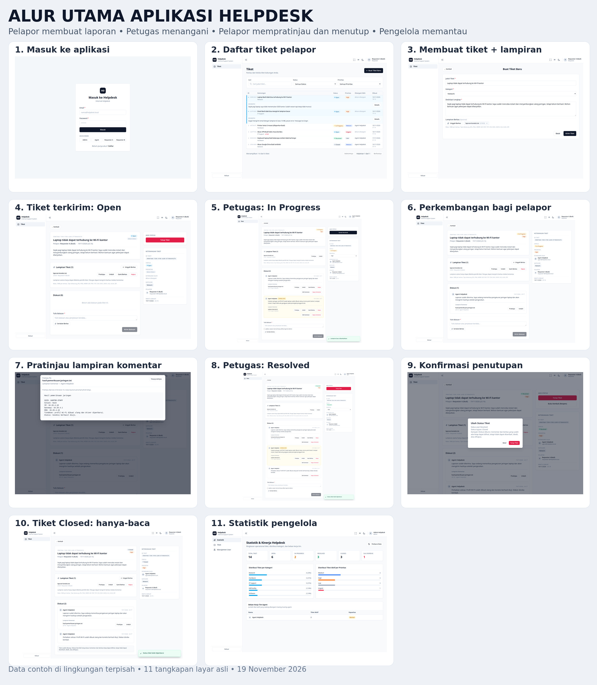

## 1. Masuk ke aplikasi

**File:** [01-halaman-masuk.png](01-halaman-masuk.png)

Pengguna mengisi email dan password. Untuk demonstrasi, tersedia akun contoh pelapor, petugas, dan pengelola. Tombol akun demo membantu mengisi email dan password; pengguna tetap menekan tombol **Masuk**.

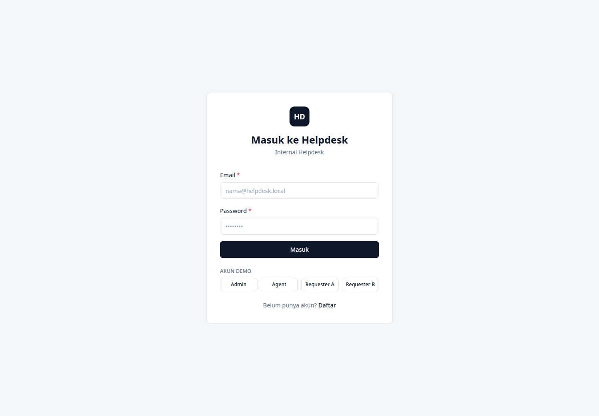

## 2. Pelapor melihat daftar tiket miliknya

**File:** [02-daftar-tiket-pelapor.png](02-daftar-tiket-pelapor.png)

Budi masuk sebagai pelapor. Halaman ini menampilkan laporan miliknya beserta status, prioritas, dan petugas yang menangani. Laporan milik Siti tidak ditampilkan kepada Budi.

Pada mode desktop, setiap baris yang deskripsinya sedang dibuka diberi **penanda garis biru di sisi kiri**. Penanda muncul pada semua deskripsi yang terbuka, bukan hanya baris pertama. Gambar ini menunjukkan dua deskripsi yang terbuka sekaligus dan keduanya memiliki penanda.

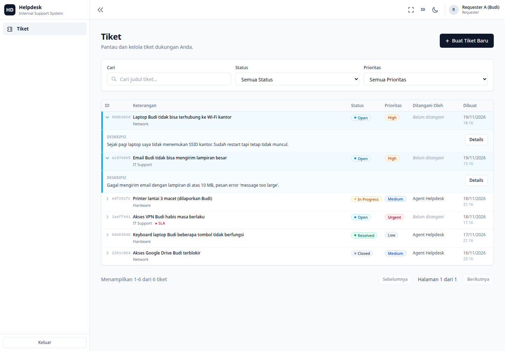

## 3. Pelapor membuat tiket dan menambahkan lampiran

**File:** [03-membuat-tiket-dan-lampiran.png](03-membuat-tiket-dan-lampiran.png)

Budi memilih **Buat Tiket Baru**, mengisi judul, kategori, dan penjelasan masalah. File contoh `laporan-koneksi.txt` juga disertakan. Setelah isian lengkap, Budi menekan **Kirim Tiket**.

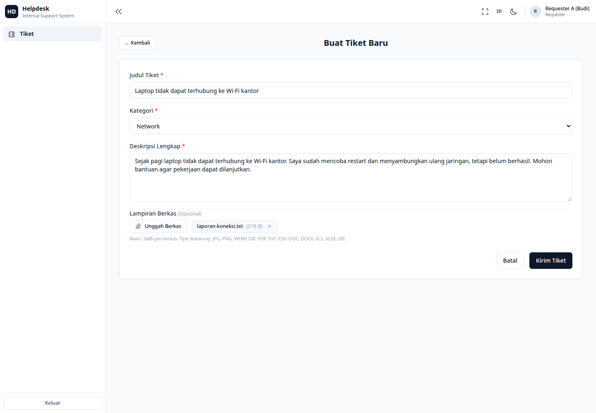

## 4. Tiket berhasil dikirim dengan status Open

**File:** [04-tiket-terkirim-open.png](04-tiket-terkirim-open.png)

Aplikasi menampilkan detail tiket yang baru dibuat. Statusnya **Open**, artinya laporan sudah masuk dan belum diproses. Lampiran tersedia pada bagian **Lampiran Tiket** dan dapat dipratinjau atau diunduh tanpa meninggalkan halaman.

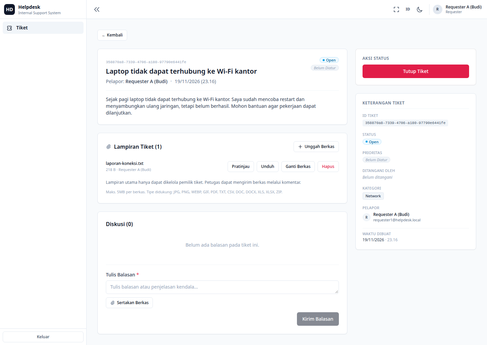

## 5. Petugas mulai menangani tiket

**File:** [05-petugas-menangani-tiket.png](05-petugas-menangani-tiket.png)

Petugas membuka tiket, mengatur prioritas menjadi **High**, lalu memilih **Proses Tiket (In Progress)** dan mengonfirmasi tindakan tersebut. Tiket otomatis ditugaskan kepada petugas yang memulai proses.

Petugas mengirim komentar untuk pelapor dan menambahkan catatan internal. Keduanya membawa berkas pada bagian **Lampiran Komentar**, sehingga jenis lampiran tiket dan lampiran komentar dapat dibedakan dengan jelas. Pada tampilan petugas, catatan internal diberi penanda **Internal Note** dengan latar berwarna kuning.

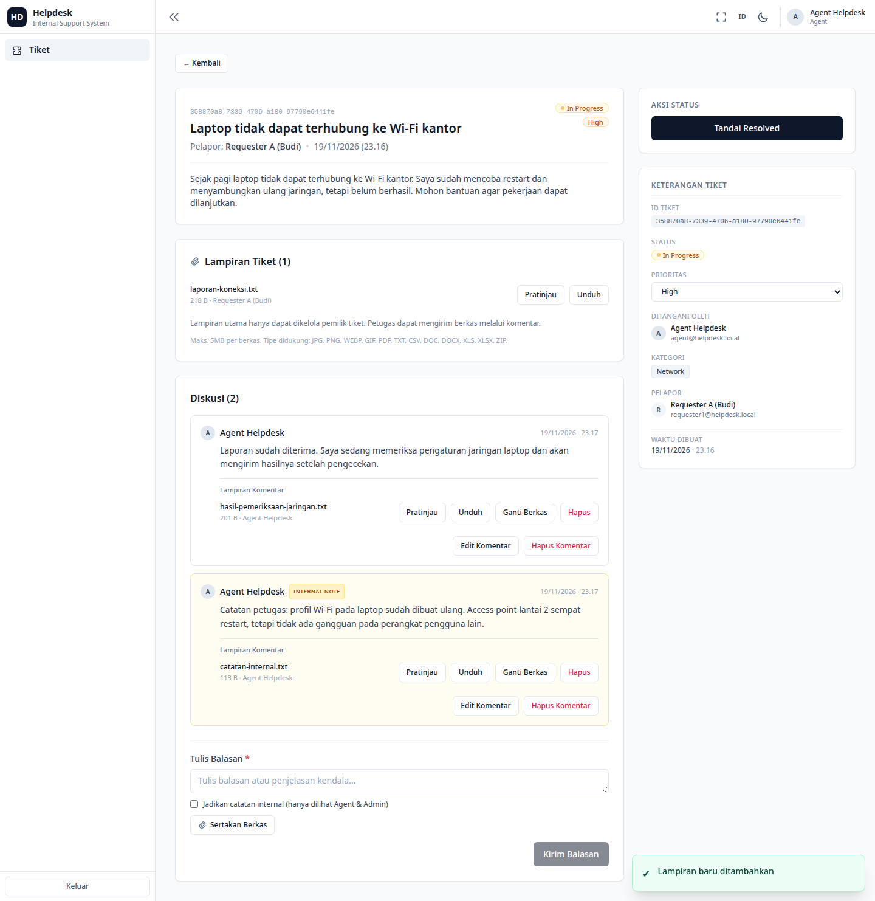

## 6. Pelapor melihat perkembangan tanpa melihat catatan internal

**File:** [06-pelapor-melihat-perkembangan.png](06-pelapor-melihat-perkembangan.png)

Tampilan Budi diperbarui secara langsung tanpa memuat ulang halaman. Budi dapat melihat status **In Progress**, nama petugas, dan komentar publik beserta lampirannya. Catatan internal yang terlihat pada gambar sebelumnya tidak muncul di tampilan pelapor.

**Perbandingan penting:** gambar 5 menampilkan dua komentar bagi petugas, sedangkan gambar 6 hanya menampilkan satu komentar yang boleh dibaca pelapor. Tombol **Pratinjau** dan **Unduh** tersedia pada lampiran komentar, sehingga pelapor dapat memeriksa isi berkas tanpa harus mengunduhnya.

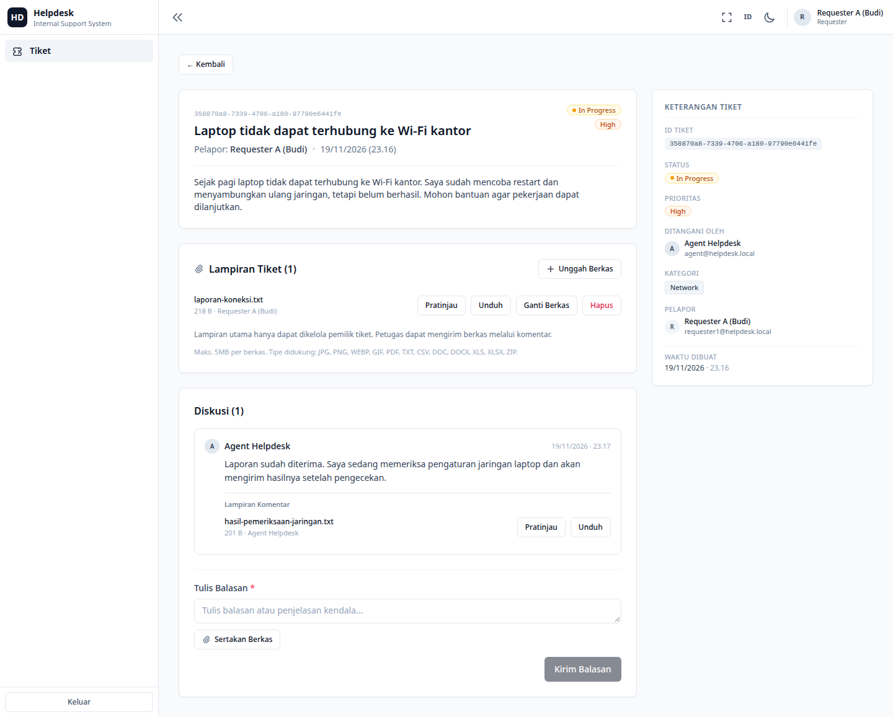

## 7. Pelapor mempratinjau lampiran komentar

**File:** [07-pratinjau-lampiran-komentar.png](07-pratinjau-lampiran-komentar.png)

Budi menekan **Pratinjau** pada lampiran komentar `hasil-pemeriksaan-jaringan.txt`. Isi berkas tampil langsung di dalam dialog aplikasi, lengkap dengan nama berkas dan keterangan bahwa berkas berasal dari lampiran komentar. Pratinjau diproses di browser; pelapor tidak perlu mengunduh berkas lebih dulu dan tidak diarahkan ke layanan penampil pihak ketiga.

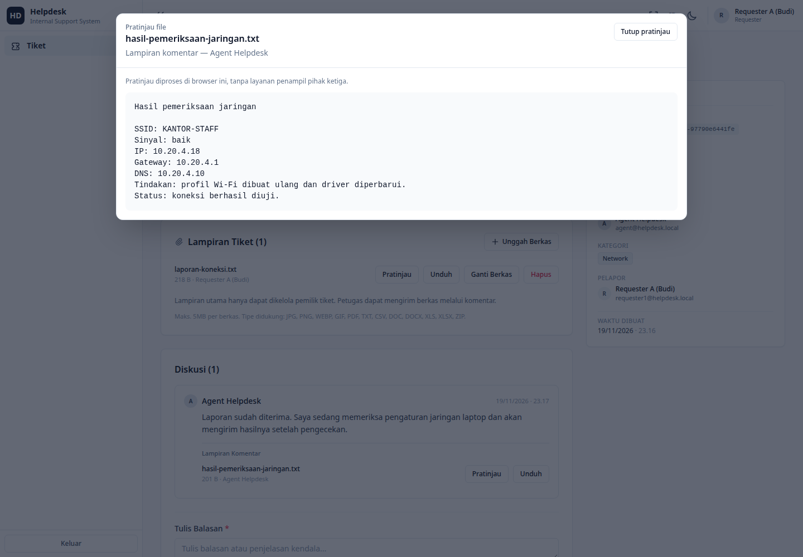

## 8. Petugas menandai masalah sudah ditangani

**File:** [08-petugas-menyelesaikan-tiket.png](08-petugas-menyelesaikan-tiket.png)

Petugas menambahkan penjelasan perbaikan, lalu memilih **Tandai Resolved** dan mengonfirmasi. Status **Resolved** berarti petugas menyatakan masalah sudah ditangani; pelapor dapat memeriksa hasilnya.

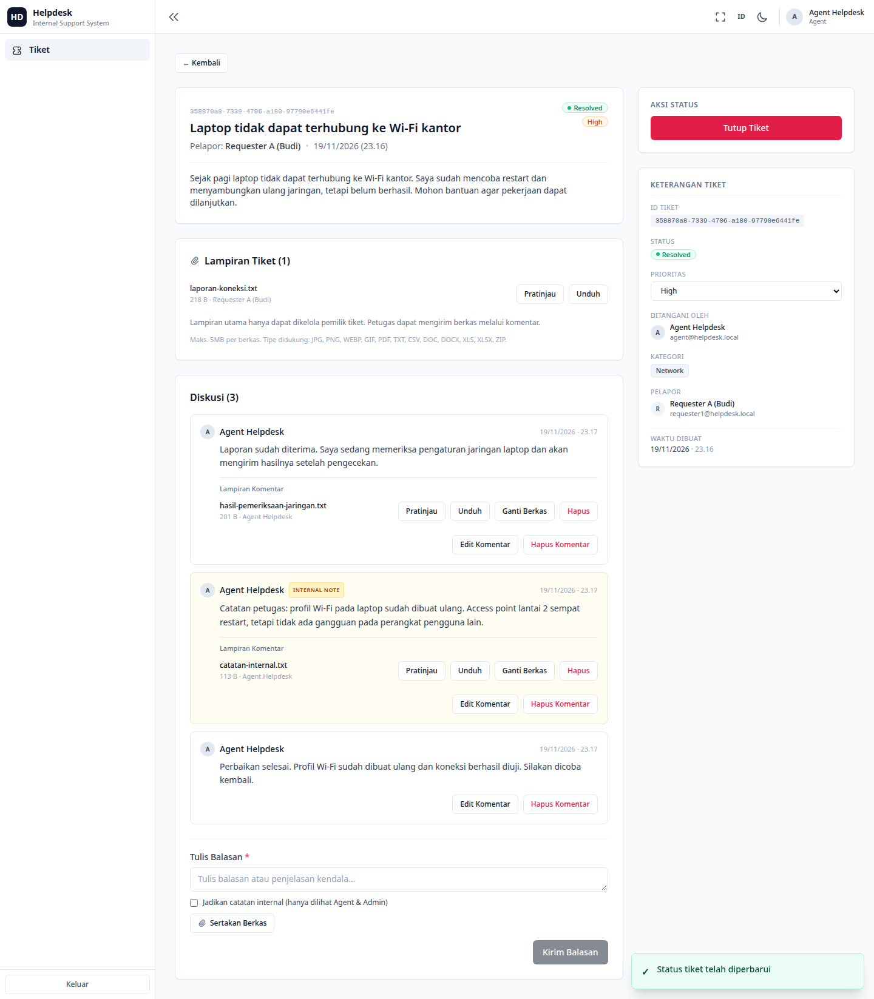

## 9. Pelapor mengonfirmasi perubahan status

**File:** [09-konfirmasi-menutup-tiket.png](09-konfirmasi-menutup-tiket.png)

Sebelum menutup tiket, Budi melihat dialog **Ubah Status Tiket**. Dialog ini menjelaskan **status asal** (Resolved), **status tujuan** (Closed), dan **dampak** perubahan: diskusi dikunci, sedangkan komentar dan berkas yang sudah ada tetap dapat dilihat. Budi dapat memilih **Batal** atau melanjutkan dengan **Tutup Tiket**.

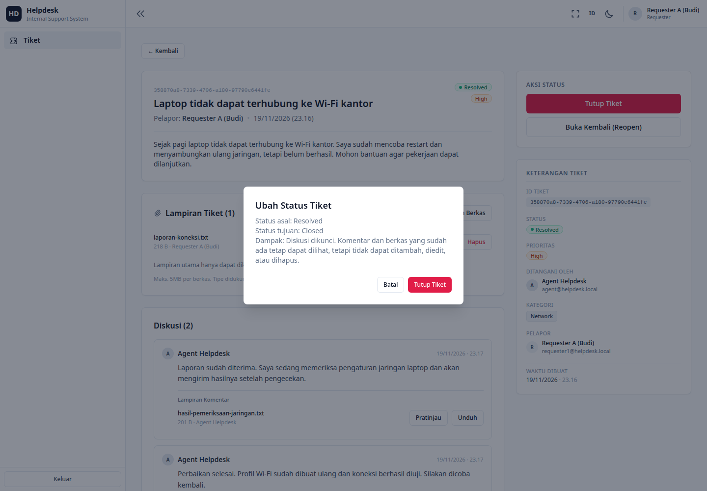

## 10. Tiket Closed bersifat hanya-baca

**File:** [10-tiket-closed-hanya-baca.png](10-tiket-closed-hanya-baca.png)

Setelah dikonfirmasi, status berubah menjadi **Closed**. Bagian diskusi menampilkan pemberitahuan bahwa komentar dan berkas tetap dapat dilihat, tetapi tidak dapat ditambah, diedit, atau dihapus. Formulir balasan tidak lagi ditampilkan. Lampiran komentar yang sudah ada masih memiliki tombol **Pratinjau** dan **Unduh**.

Lampiran tiket utama tetap dapat dikelola oleh pemilik tiket, sedangkan diskusi dan lampiran komentar mengikuti aturan hanya-baca.

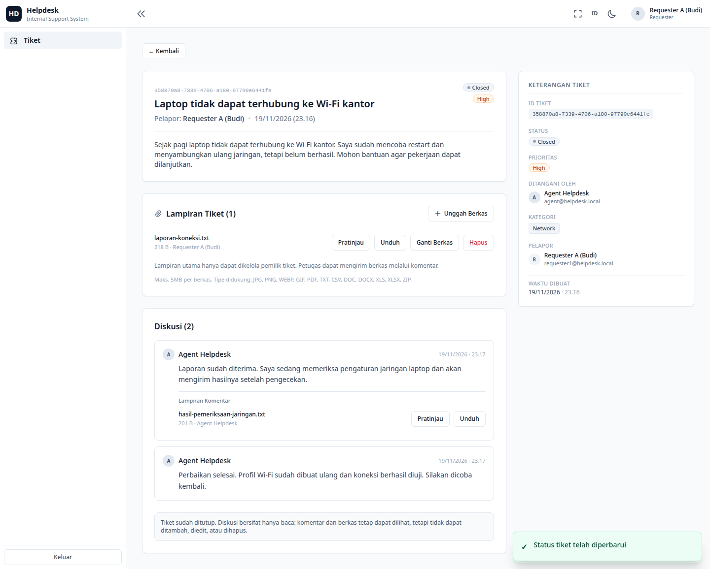

## 11. Pengelola melihat ringkasan pekerjaan

**File:** [11-statistik-pengelola.png](11-statistik-pengelola.png)

Pengelola masuk dan membuka halaman statistik. Halaman ini menampilkan jumlah tiket per status, laporan terlambat, pembagian kategori dan prioritas, serta beban kerja petugas.

Pada percobaan ini terdapat **14 tiket**: 13 tiket bawaan dan satu tiket baru dari alur di atas. Rinciannya: **6 Open**, **2 In Progress**, **3 Resolved**, **3 Closed**, dan **1 SLA Overdue**. Kategori Network berisi 4 tiket, sedangkan beban kerja aktif Agent Helpdesk tercatat 2 tiket dengan kapasitas **Normal**.

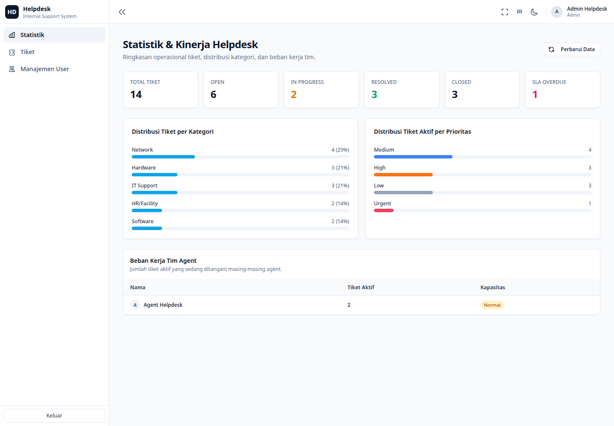

## Pemeriksaan yang berhasil dilakukan

Selain mengambil gambar, alur berikut juga diperiksa langsung:

- Akun pelapor, petugas, dan pengelola berhasil masuk melalui formulir aplikasi.
- Tiket dan lampiran berhasil disimpan; lampiran dapat dipratinjau dan diunduh dengan isi yang sama.
- Setiap deskripsi tiket yang terbuka pada tabel desktop memiliki penanda, termasuk saat beberapa deskripsi dibuka bersamaan.
- Status berubah **Open → In Progress → Resolved → Closed** melalui tombol aplikasi beserta konfirmasi status asal, status tujuan, dan dampak.
- Tiket otomatis ditugaskan kepada petugas yang memulai penanganan.
- Komentar publik muncul pada pelapor tanpa memuat ulang halaman.
- Lampiran komentar dapat dipratinjau langsung di aplikasi tanpa mengunduh berkas.
- Catatan internal tidak dikirim oleh API kepada pelapor dan tidak tampil di halamannya.
- Setelah tiket **Closed**, formulir balasan disembunyikan dan diskusi menjadi hanya-baca, sementara komentar serta berkas lama tetap dapat dibuka.
- Ringkasan statistik sesuai dengan data percobaan setelah tiket ditutup.

Pemeriksaan ini membuktikan alur demonstrasi tersebut, bukan jaminan bahwa seluruh kemungkinan penggunaan sudah diuji. Lingkungan percobaan dibersihkan setelah pengambilan gambar; file bukti ini tetap dapat dibuka tanpa menjalankan aplikasi.

## Cara menggunakan bukti ini

- Untuk melihat alur dengan cepat, buka `00-ringkasan-alur.jpg`.
- Untuk membaca detail, buka gambar bernomor `01` sampai `11` secara berurutan.
- Untuk mengirim seluruh bukti sekaligus, gunakan arsip `docs/BUKTI_ALUR_UTAMA.zip` yang berisi panduan ini dan seluruh gambar.
- File ini merupakan dokumentasi lokal dan tidak ditautkan dari README utama.
